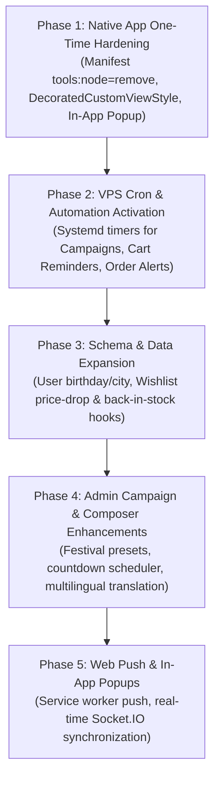

# Comprehensive Notification & Campaign System Audit Report

> **Audit Date:** 26 November 2026  
> **Target Systems Audited:**
> - Website & Backend: Next.js 16.2.10 (Turbopack, App Router), Prisma ORM 6.19.3, Neon PostgreSQL, Linux VPS (PM2)
> - Customer Mobile App: `intrihub-mobile` (Expo SDK 57, React Native 0.86.3, React 19.2.3, `com.intrihub.app`)
> - Business Mobile App: `intrihub-business` (Expo SDK 57, React Native 0.86.3, React 19.2.3, `com.intrihub.business`)
> **Audit Mode:** Read-Only Codebase, Schema, & Infrastructure Inspection (Zero DB/file modifications)

---

## Executive Summary

IntriHub already possesses a substantial amount of notification and campaign infrastructure—including an advanced **Admin Campaign Composer** (`app/admin/campaigns/page.tsx`), **Abandoned Cart Automation** (`lib/cart-reminder-runner.ts`), **Quiet Hours & Daily Frequency Capping** (`lib/notification-service.ts`), **In-App Notification Center** (`components/notifications/NotificationCenter.tsx`), and a **Live Hourly App-Update Cron** (`lib/app-update-notifier.ts`).

However, the architecture suffers from:
1. **Multiple Conflicting Token Tables** (`DeviceToken`, `MobilePushToken`, `User.pushToken`).
2. **Missing Systemd/Cron Triggers on the Production VPS** for cart reminders, order SLAs, and campaigns.
3. **Android FCM Service Collision** (`ExpoFirebaseMessagingService` preempts custom native `IntriHubFirebaseMessagingService` because `tools:node="remove"` was omitted).
4. **Disabled Socket.IO in Production** because PM2 executes Next.js built-in `next start` rather than `server.ts`.
5. **Completely Missing Web Push & Birthday/Festival Data**.

---

## Section A: Current Push Notification Flow

### 1. Push Stack Used Today
- **Push Gateway / Service Provider:** **Expo Push API** (`https://exp.host/--/api/v2/push/send`). All push notifications are dispatched via raw HTTP `fetch()` requests directly to Expo servers.
- **Backend Packages** ([package.json](file:///d:/Intrihub/package.json#L22-L46)):
  - No `firebase-admin` or `@expo/server-sdk` is installed. HTTP `fetch()` is used directly in [lib/push-notifications.ts](file:///d:/Intrihub/lib/push-notifications.ts#L62-L135).
- **Customer App (`intrihub-mobile`)** ([package.json](file:///d:/Intrihub/intrihub-mobile/package.json#L11-L59)):
  - `expo`: `~57.0.0`
  - `expo-notifications`: `~57.0.21`
  - `expo-constants`: `~57.0.19`
  - `expo-application`: `~57.0.3`
  - `react-native`: `0.86.3`
  - `react`: `19.2.3`
  - *No `@react-native-firebase/*`, `@notifee/react-native`, or `OneSignal`.*
- **Business App (`intrihub-business`)** ([package.json](file:///d:/Intrihub/intrihub-business/package.json#L11-L58)):
  - `expo`: `^57.0.0`
  - `expo-notifications`: `~57.0.20`
  - `expo-constants`: `~57.0.19`
  - `expo-application`: `~57.0.3`
  - `react-native`: `0.86.3`
  - `react`: `19.2.3`
  - *No `@react-native-firebase/*`, `@notifee/react-native`, or `OneSignal`.*

### 2. Token Registration Architecture
- **Token Acquisition:**
  - Customer: [intrihub-mobile/src/hooks/usePushNotifications.ts](file:///d:/Intrihub/intrihub-mobile/src/hooks/usePushNotifications.ts#L83-L91) calls `Notifications.getExpoPushTokenAsync({ projectId: "7c786f97-0217-4a68-b51f-14499a3311a2" })`.
  - Business: [intrihub-business/src/hooks/usePushNotifications.ts](file:///d:/Intrihub/intrihub-business/src/hooks/usePushNotifications.ts#L70-L80) calls `Notifications.getExpoPushTokenAsync()`.
- **Backend Endpoints:**
  1. `POST /api/mobile/push-token` ([app/api/mobile/push-token/route.ts](file:///d:/Intrihub/app/api/mobile/push-token/route.ts#L13-L53)): Primary authenticated route. Calls `registerPushToken()`.
  2. `POST /api/mobile/push/register-token` ([app/api/mobile/push/register-token/route.ts](file:///d:/Intrihub/app/api/mobile/push/register-token/route.ts#L13-L52)): Legacy/secondary authenticated route. Calls `registerPushToken()`.
  3. `POST /api/mobile/push/register` ([app/api/mobile/push/register/route.ts](file:///d:/Intrihub/app/api/mobile/push/register/route.ts#L4-L36)): Unauthenticated legacy route. Upserts into `MobilePushToken` only.
- **Database Models & Storage:**
  - [prisma/schema.prisma](file:///d:/Intrihub/prisma/schema.prisma#L1189-L1208): `model DeviceToken` (fields: `id`, `userId`, `role`, `platform`, `appType`, `token` [unique], `appVersion`, `isActive`, `lastSeenAt`, `createdAt`, `updatedAt`).
  - [prisma/schema.prisma](file:///d:/Intrihub/prisma/schema.prisma#L1175-L1188): `model MobilePushToken` (fields: `id`, `userId`, `token` [unique], `platform`, `deviceId`, `createdAt`, `updatedAt`).
  - [prisma/schema.prisma](file:///d:/Intrihub/prisma/schema.prisma#L13-L38): `User.pushToken` (single string field on User model).
- **Cleanup of Stale / Invalid Tokens:**
  - ⚠️ **Partial**: When Expo returns `DeviceNotRegistered`, `deleteDeadPushToken()` in [lib/push-notifications.ts](file:///d:/Intrihub/lib/push-notifications.ts#L293-L305) and [lib/notification-service.ts](file:///d:/Intrihub/lib/notification-service.ts#L364-L372) deletes the token across all 3 tables.
  - ❌ **Missing**: No periodic sweep deletes tokens with `lastSeenAt > 60 days` or uninstalled devices until a send failure occurs.
- **Duplicate Registration / Multi-App Conflict:**
  - When a user installs **both** the Customer App and the Business App on the same phone, Expo generates two distinct tokens (belonging to experiences `@sahil_sheikh78/intrihub` and `@sahil_sheikh78/intrihub-business`).
  - Both tokens are registered in `DeviceToken` under the **same `userId`**. When bulk cron queries execute, both tokens receive notifications.

### 3. Backend Push Dispatchers & Payload Formats
Every backend push location:
1. [lib/push-notifications.ts](file:///d:/Intrihub/lib/push-notifications.ts#L62): `sendExpoPushNotification(payload)` — Central batch dispatcher with batch chunking (max 100), experience split on `PUSH_TOO_MANY_EXPERIENCE_IDS`, receipt logging.
2. [lib/push-notifications.ts](file:///d:/Intrihub/lib/push-notifications.ts#L383): `notifyVendorPush(params)` — Sends new order alert to vendor on channel `orders_high_importance` with sound `default`/`ring.mp3`.
3. [lib/push-notifications.ts](file:///d:/Intrihub/lib/push-notifications.ts#L460): `sendPushToUser(userId, payload)` — Sends general customer notification to all tokens matching `userId`.
4. [lib/push-notifications.ts](file:///d:/Intrihub/lib/push-notifications.ts#L519): `sendCustomerOrderStatusPush(userId, orderId, status)` — Customer order lifecycle updates (`CONFIRMED`, `PACKED`, `DISPATCHED`, `DELIVERED`).
5. [lib/notification-service.ts](file:///d:/Intrihub/lib/notification-service.ts#L99): `sendNotification(options)` — Comprehensive engine handling quiet hours, daily frequency caps, store pause switches, and idempotency.
6. [lib/campaign-runner.ts](file:///d:/Intrihub/lib/campaign-runner.ts#L33): `dispatchCampaign(campaignId)` — Resolves audience and broadcasts campaign notifications.
7. [lib/cart-reminder-runner.ts](file:///d:/Intrihub/lib/cart-reminder-runner.ts#L78): `runCartRemindersStep()` — 4-stage abandoned cart sequence.
8. [lib/app-update-notifier.ts](file:///d:/Intrihub/lib/app-update-notifier.ts#L85): `runHourlyAppUpdateReminder(options)` — Outdated version check and Play Store reminder push.
9. [lib/actions/orders.ts](file:///d:/Intrihub/lib/actions/orders.ts#L897-L950,L1221): Order placed, confirmed, cancelled, rider assigned.
10. [lib/actions/vendor.ts](file:///d:/Intrihub/lib/actions/vendor.ts#L513,L1450-L1462): Vendor approval alerts, order status transitions.
11. [lib/actions/rider-assignment.ts](file:///d:/Intrihub/lib/actions/rider-assignment.ts#L249,L431,L542,L576): Rider dispatch and delivery arrival alerts.
12. [app/api/cron/order-alerts/route.ts](file:///d:/Intrihub/app/api/cron/order-alerts/route.ts#L3-L45): Escalating vendor order alert sound reminder.
13. [app/api/cron/sla-checker/route.ts](file:///d:/Intrihub/app/api/cron/sla-checker/route.ts#L65,L127): SLA breach alerts for vendors and admins.

### 4. Root Cause of the Double "Update Available!" Notification
In the user's screenshot (`media_1795669751641_9bff18e2.jpg`), two notifications arrived simultaneously:
1. Top: `Intrihub • now` with text *"A fresh update of IntriHub is available with instant order notifications..."*
2. Bottom: `Update Available! • now` with text *"Version 1.0.30 brings background and loc..."*

**Root Cause:**
1. **Sender:** [lib/app-update-notifier.ts](file:///d:/Intrihub/lib/app-update-notifier.ts#L180-L245), executed by `/api/cron/app-update-reminder` via the VPS systemd timer `intrihub-app-update.timer`.
2. **Why two arrive together:** The user has **both apps installed on the single phone**. 
   - Token 1 is registered to `com.intrihub.app` (Customer).
   - Token 2 is registered to `com.intrihub.business` (Business).
   - The hourly cron queried all device tokens, evaluated the customer config (`latestVersion: "1.2.21"`) and business config (`latestVersion: "1.0.36"`), and found both tokens eligible.
   - The top notification body was pulled directly from `StoreSettings.appVersionConfig.customer.android.message`, while the bottom notification body came from `StoreSettings.appVersionConfig.business.android.message`.

### 5. Android Configuration Details
- **Settings in `app.json`:**
  - Customer ([intrihub-mobile/app.json](file:///d:/Intrihub/intrihub-mobile/app.json#L77-L84)):
    - Plugin: `expo-notifications`, `icon: "./assets/notification-icon.png"`, `color: "#F26522"`, `sounds: ["./assets/sounds/ring.mp3"]`.
  - Business ([intrihub-business/app.json](file:///d:/Intrihub/intrihub-business/app.json#L78-L85)):
    - Plugin: `expo-notifications`, `icon: "./assets/notification-icon.png"`, `color: "#F26522"`, `sounds: ["./assets/sounds/ring.mp3"]`.
- **Manifest Metadata** ([intrihub-mobile/android/app/src/main/AndroidManifest.xml](file:///d:/Intrihub/intrihub-mobile/android/app/src/main/AndroidManifest.xml#L46-L49)):
  - `com.google.firebase.messaging.default_notification_color`: `@color/notification_icon_color` (`#F26522`)
  - `com.google.firebase.messaging.default_notification_icon`: `@drawable/notification_icon`
  - `expo.modules.notifications.default_notification_color`: `@color/notification_icon_color`
  - `expo.modules.notifications.default_notification_icon`: `@drawable/notification_icon`
- **Origin of Orange Circle & Truck Icon:**
  Android generates notification icons using the monochrome alpha mask `res/drawable/notification_icon.png` (the IntriHub delivery truck) and tints the surrounding badge circle using `notification_icon_color` (`#F26522`, IntriHub brand orange).
- **Notification Channels Registered:**
  - Customer ([intrihub-mobile/src/hooks/usePushNotifications.ts](file:///d:/Intrihub/intrihub-mobile/src/hooks/usePushNotifications.ts#L121-L180)):
    - `app_update_ring_v1`: MAX importance, sound `ring.mp3`, light `#003478`
    - `user_success_v1`: MAX importance, sound `default`, light `#10B981`
    - `user_alert_v1`: MAX importance, sound `default`, light `#EF4444`
    - `user_arrival_v1`: MAX importance, sound `default`, light `#F26522`
    - `user_promo_v1`: DEFAULT importance, sound `default`, light `#8B5CF6`
  - Business ([intrihub-business/src/hooks/usePushNotifications.ts](file:///d:/Intrihub/intrihub-business/src/hooks/usePushNotifications.ts#L95-L150)):
    - `orders_high_importance`: MAX importance, sound `ring.mp3`, vibration enabled
    - `app_update_ring_v1`: MAX importance, sound `ring.mp3`

### 6. Handlers & Deep-Link Routing
- **Foreground Handlers:**
  - Customer: `Notifications.addNotificationReceivedListener` in [usePushNotifications.ts](file:///d:/Intrihub/intrihub-mobile/src/hooks/usePushNotifications.ts#L187). Updates in-app badges.
  - Business: [usePushNotifications.ts](file:///d:/Intrihub/intrihub-business/src/hooks/usePushNotifications.ts#L165). If `data.type === "NEW_ORDER"` or `isNewOrder === true`, triggers native loop alarm `orderAlarm.triggerAlarm()`.
- **Response / Background / Killed Tap Handlers:**
  - Customer: `Notifications.addNotificationResponseReceivedListener` in [usePushNotifications.ts](file:///d:/Intrihub/intrihub-mobile/src/hooks/usePushNotifications.ts#L205).
  - Business: [usePushNotifications.ts](file:///d:/Intrihub/intrihub-business/src/hooks/usePushNotifications.ts#L195).
- **Supported Deep-Link Targets Today:**
  - Customer:
    - `/order/[id]` or `/orders/[id]`
    - `/cart`
    - `/category/[category]`
    - `/shop`
    - `/offers`
    - `/product/[slug]`
    - `storeUrl` (Google Play redirection)
  - Business:
    - `/(vendor)/orders`
    - `/(vendor)/orders/[id]`
    - `/(vendor)/earnings`
    - `/(vendor)/inventory`
    - `/(vendor)/profile`

### 7. iOS Status
- `intrihub-mobile/app.json` declares `UIBackgroundModes: ["remote-notification"]` and `entitlements: { "aps-environment": "production" }`.
- ⚠️ **Blocked**: Apple Push Notification Service (APNs) Auth Key (`.p8`) is not uploaded to Expo Application Services (EAS). Without APNs credentials registered in Expo Dashboard, remote pushes to iOS physical devices fail.

### 8. App Codebase Comparison
- Customer App and Business App maintain **independent push implementations** with separate project IDs, channel sets, and sound handlers. They share common backend API endpoints (`/api/mobile/push-token`).

---

## Section B: Existing Admin-Side Capabilities

### 1. Modules in Web Super Admin & Business Admin Console
- **Admin Campaigns Module:**
  - Route: `/admin/campaigns` ([app/admin/campaigns/page.tsx](file:///d:/Intrihub/app/admin/campaigns/page.tsx))
  - Size: 59 KB full-featured interface.
  - Features: Live mobile phone preview, audience filter dropdown, date/time scheduler, test send modal, platform selector (all/android/ios), delivery statistics bar.
- **Admin Direct Notifications Module:**
  - Route: `/admin/notifications` ([app/admin/notifications/page.tsx](file:///d:/Intrihub/app/admin/notifications/page.tsx))
  - Features: Send manual push to single user, single vendor, all users, or all vendors. Full paginated `NotificationLog` viewer with filter by type/status.
- **Admin Content & Banners Module:**
  - Route: `/admin/content` ([app/admin/content/page.tsx](file:///d:/Intrihub/app/admin/content/page.tsx))
  - Features: Homepage hero banner management, `OfferBanner` CRUD (title, subtitle, badge, cta, href, image, bgGradient, isActive).
- **Admin Store Settings Module:**
  - Route: `/admin/settings` ([app/admin/settings/page.tsx](file:///d:/Intrihub/app/admin/settings/page.tsx))
  - Features: `StoreSettings` editor, delivery slots, `appVersionConfig` updates, auto-accept toggles, order ringing settings.
- **Admin Coupons Module:**
  - Route: `/admin/coupons` ([app/admin/coupons/page.tsx](file:///d:/Intrihub/app/admin/coupons/page.tsx))
  - Features: Coupon creation, percentage/flat discounts, usage caps, min order value.
- **Admin WhatsApp Broadcast Module:**
  - Route: `/admin/connect` ([app/admin/connect/page.tsx](file:///d:/Intrihub/app/admin/connect/page.tsx))
  - Features: WhatsApp broadcast groups, template selection, message logs (`BroadcastGroup`, `BroadcastLog`).

### 2. Manual Push Sending Capabilities
- **Direct Send Form** ([app/admin/notifications/page.tsx](file:///d:/Intrihub/app/admin/notifications/page.tsx#L32-L43)):
  - Target audience choices: `user` (by userId), `vendor` (by vendorId), `all_users`, `all_vendors`.
  - Input fields: `type` (PROMO_OFFER, SYSTEM_ALERT, ORDER_UPDATE, CUSTOM), `title`, `body`, `imageUrl`, `deepLink`.
- **Campaign Composer** ([app/admin/campaigns/page.tsx](file:///d:/Intrihub/app/admin/campaigns/page.tsx)):
  - Audience targeting: `all`, `no_orders_days` (inactive N days), `ordered_days` (ordered within N days), `cart_has_items` (abandoned cart), `city` (specific city).
  - Target links: `offers`, `cart`, `item:ID`, `category:ID`, `order:ID`.

### 3. Reusable UI Components
- **Image Upload:** [app/api/upload/route.ts](file:///d:/Intrihub/app/api/upload/route.ts). Reusable via [components/admin/ImageUploadManager.tsx](file:///d:/Intrihub/components/admin/ImageUploadManager.tsx). Saves to VPS filesystem at `public/uploads/` with Sharp image processing. Max file size: 10 MB. No cloud bucket (Vercel Blob/S3) is configured.
- **Color Picker:** [components/admin/ColorPalettePickerModal.tsx](file:///d:/Intrihub/components/admin/ColorPalettePickerModal.tsx).
- **Rich Text Editor:** [components/admin/guides/RichTextEditor.tsx](file:///d:/Intrihub/components/admin/guides/RichTextEditor.tsx).
- **Date/Time Scheduler:** HTML5 `<input type="datetime-local" />` in [app/admin/campaigns/page.tsx](file:///d:/Intrihub/app/admin/campaigns/page.tsx).
- **Charts:** [components/admin/SalesChart.tsx](file:///d:/Intrihub/components/admin/SalesChart.tsx).

### 4. Admin Auth & Security
- **Authentication:** HMAC-SHA256 signed cookie `intrihub_admin_token` or Bearer token generated with `ADMIN_SESSION_SECRET` ([lib/server-auth.ts](file:///d:/Intrihub/lib/server-auth.ts#L4-L88)).
- **Email Whitelist:** `ADMIN_ALLOWED_EMAIL` environment variable with fallback to `admin@intrihub.com` ([lib/server-auth.ts](file:///d:/Intrihub/lib/server-auth.ts#L167-L170), [lib/mobile-auth.ts](file:///d:/Intrihub/lib/mobile-auth.ts#L100)).
- **Audit Logging:**
  - `AdminAuditLog` ([prisma/schema.prisma](file:///d:/Intrihub/prisma/schema.prisma#L933)): Logs admin ID, action, entity, before/after JSON, and IP.
  - `NotificationLog` ([prisma/schema.prisma](file:///d:/Intrihub/prisma/schema.prisma#L1637)): Logs every dispatched push with `sentByAdminId`.

---

## Section C: Data and Schema

### 1. Prisma Models Overview

```prisma
// 1. In-App User Notifications (Inbox)
model Notification {
  id        String   @id @default(cuid())
  userId    String
  title     String
  message   String
  type      String   @default("info") // order | promo | system | info
  isRead    Boolean  @default(false)
  link      String?
  createdAt DateTime @default(now())
  user      User     @relation(fields: [userId], references: [id], onDelete: Cascade)
  @@index([userId])
}

// 2. User Notification Preferences
model NotificationPreference {
  id                   String   @id @default(cuid())
  userId               String   @unique
  orderUpdates         Boolean  @default(true)
  promotional          Boolean  @default(true)
  email                Boolean  @default(true)
  sms                  Boolean  @default(true)
  whatsapp             Boolean  @default(true)
  offersEnabled        Boolean  @default(true)
  cartRemindersEnabled Boolean  @default(true)
  updatedAt            DateTime @updatedAt
  user                 User     @relation(fields: [userId], references: [id], onDelete: Cascade)
}

// 3. Primary Multi-Role Device Tokens
model DeviceToken {
  id         String    @id @default(cuid())
  userId     String
  role       String    @default("customer") // customer | vendor | rider | admin
  platform   String    @default("android")  // android | ios | web
  appType    String    @default("user")     // user | business
  token      String    @unique
  appVersion String?
  isActive   Boolean   @default(true)
  lastSeenAt DateTime  @default(now())
  createdAt  DateTime  @default(now())
  updatedAt  DateTime  @updatedAt
  user       User      @relation(fields: [userId], references: [id], onDelete: Cascade)
  @@index([userId])
  @@index([role])
  @@index([token])
  @@index([appType])
}

// 4. Marketing Push Campaigns
model Campaign {
  id          String            @id @default(cuid())
  title       String            // max 40 chars
  body        String            // max 90 chars
  imageUrl    String?
  target      String            @default("offers")
  audience    Json?
  scheduledAt DateTime?
  status      String            @default("draft") // draft | scheduled | sending | sent | cancelled
  platforms   String            @default("all")
  sendMode    String            @default("scheduled")
  createdBy   String?
  sentAt      DateTime?
  stats       Json?
  createdAt   DateTime          @default(now())
  updatedAt   DateTime          @updatedAt
  logs        NotificationLog[]
  @@index([status, scheduledAt])
}

// 5. Granular Notification Delivery & Open Logs
model NotificationLog {
  id            String    @id @default(cuid())
  userId        String
  recipient     String?
  type          String
  campaignId    String?
  cartVersion   Int?
  platform      String?
  status        String    @default("sent") // sent | delivered | skipped | failed | opened
  receiptStatus String?
  skipReason    String?
  payload       Json?
  error         String?
  sentByAdminId String?
  createdAt     DateTime  @default(now())
  openedAt      DateTime?
  user          User      @relation(fields: [userId], references: [id], onDelete: Cascade)
  campaign      Campaign? @relation(fields: [campaignId], references: [id], onDelete: SetNull)
  @@index([userId, createdAt])
  @@index([type])
  @@index([campaignId])
}
```

### 2. User Model Gap Analysis
- [prisma/schema.prisma](file:///d:/Intrihub/prisma/schema.prisma#L13-L38):
  - `birthday`: ❌ **NOT FOUND** in `User` model. Searched: `prisma/schema.prisma` lines 13-40.
  - `city`: ❌ **NOT FOUND** directly on `User`. City only exists inside `Address` (`model Address` line 468) and `VendorProfile` (`model VendorProfile` line 1032).
  - `lastLogin` / `lastActive`: ❌ **NOT FOUND** on `User`. Only exists as `DeviceToken.lastSeenAt`.

### 3. In-App Notification Inbox
- **Website:** Bell dropdown in [components/notifications/NotificationCenter.tsx](file:///d:/Intrihub/components/notifications/NotificationCenter.tsx), backed by `Notification` model.
- **Mobile Apps:** [intrihub-mobile/app/notifications.tsx](file:///d:/Intrihub/intrihub-mobile/app/notifications.tsx) and [intrihub-business/app/(vendor)/notifications.tsx](file:///d:/Intrihub/intrihub-business/app/(vendor)/notifications.tsx). Calls `GET /api/mobile/notifications`.

### 4. Notification Preferences & Quiet Hours
- **Opt-out switches:** `offersEnabled`, `cartRemindersEnabled` stored in `NotificationPreference`.
- **Quiet Hours:** Hardcoded in [lib/notification-service.ts](file:///d:/Intrihub/lib/notification-service.ts#L45-L80) (`isKolkataQuietHours`) for 21:00 to 08:00 Asia/Kolkata. Can be customized via `StoreSettings.quietHoursStart` and `StoreSettings.quietHoursEnd`.
- **Daily Cap:** Enforced at `maxPushPerDay: 2` in [lib/notification-service.ts](file:///d:/Intrihub/lib/notification-service.ts#L207-L239).

### 5. Languages & Localization
- User language is persisted in `User.language` ("en" | "hi" | "kn") via [app/api/user/language/route.ts](file:///d:/Intrihub/app/api/user/language/route.ts) and cookie `intrihub_lang`.
- ⚠️ **Gap:** Push notification messages are currently sent in **English only**. Dynamic translation using `TranslationCache` / Gemini AI exists for web catalog text, but is not connected to the push notification sender.

---

## Section D: Triggers and Automation

### 1. Events Sending Notifications Today

| Event | File & Line | Target Role | Channel | Sound |
|---|---|---|---|---|
| **Order Auto-Confirmed** | [lib/actions/orders.ts#L899](file:///d:/Intrihub/lib/actions/orders.ts#L899) | Customer | `user_success_v1` | `default` |
| **New Incoming Order** | [lib/actions/orders.ts#L938](file:///d:/Intrihub/lib/actions/orders.ts#L938) | Vendor | `orders_high_importance` | `ring.mp3` |
| **Order Cancelled** | [lib/actions/orders.ts#L1221](file:///d:/Intrihub/lib/actions/orders.ts#L1221) | Customer | `user_alert_v1` | `default` |
| **Order Packed** | [lib/actions/vendor.ts#L1452](file:///d:/Intrihub/lib/actions/vendor.ts#L1452) | Customer | `user_success_v1` | `default` |
| **Out for Delivery** | [lib/actions/vendor.ts#L1454](file:///d:/Intrihub/lib/actions/vendor.ts#L1454) | Customer | `user_arrival_v1` | `default` |
| **Order Delivered** | [lib/actions/vendor.ts#L1456](file:///d:/Intrihub/lib/actions/vendor.ts#L1456) | Customer | `user_success_v1` | `default` |
| **Vendor Order Alert Ringing** | [app/api/cron/order-alerts/route.ts#L25](file:///d:/Intrihub/app/api/cron/order-alerts/route.ts#L25) | Vendor | `orders_high_importance` | `ring.mp3` |
| **Vendor SLA Breach** | [app/api/cron/sla-checker/route.ts#L65](file:///d:/Intrihub/app/api/cron/sla-checker/route.ts#L65) | Vendor & Admin | `orders_high_importance` | `ring.mp3` |
| **Abandoned Cart Sequence** | [lib/cart-reminder-runner.ts#L78](file:///d:/Intrihub/lib/cart-reminder-runner.ts#L78) | Customer | `user_promo_v1` | `default` |
| **Marketing Campaign** | [lib/campaign-runner.ts#L33](file:///d:/Intrihub/lib/campaign-runner.ts#L33) | Customers (Audience) | `user_promo_v1` | `default` |
| **App Update Reminder** | [lib/app-update-notifier.ts#L85](file:///d:/Intrihub/lib/app-update-notifier.ts#L85) | Outdated Users | `app_update_ring_v1` | `ring.mp3` |

### 2. Stock & Price-Drop Events
- **Low Stock Threshold:** Configured in `StoreSettings.lowStockThreshold` (default: 10).
- **Price-Drop & Back-in-Stock:** ⚠️ **Partial / Unwired**.
  - `WISHLIST_PRICE_DROP` and `BACK_IN_STOCK` exist as defined catalog types in [lib/notifications/catalog.ts](file:///d:/Intrihub/lib/notifications/catalog.ts#L463-L475) and [lib/notification-service.ts](file:///d:/Intrihub/lib/notification-service.ts#L9-L10).
  - ❌ **Missing Trigger:** No webhook or listener triggers when a vendor updates stock or decreases prices. Searched: `lib/actions/vendor.ts`, `app/api/vendor/products/[id]`.

### 3. Cron Infrastructure Status
- **Render Cron:** NOT FOUND in codebase.
- **Node-Cron / BullMQ / Upstash QStash:** NOT FOUND in `package.json`. No Redis instance or queue worker exists.
- **VPS Systemd Timers (Live Inspection on `50.6.200.135`):**
  - ✅ `intrihub-app-update.timer`: **ACTIVE & RUNNING HOURLY** (`/usr/local/bin/intrihub-hourly-update-cron.sh`).
  - ❌ `cart-reminders.timer`: **NOT FOUND**. The route `/api/cron/cart-reminders` is not automated on the VPS.
  - ❌ `campaign-sender.timer`: **NOT FOUND**. The route `/api/cron/campaign-sender` is not automated on the VPS.
  - ❌ `order-alerts.timer`: **NOT FOUND**. The route `/api/cron/order-alerts` is not automated on the VPS.
  - ❌ `sla-checker.timer`: **NOT FOUND**. The route `/api/cron/sla-checker` is not automated on the VPS.

### 4. Socket.IO Real-Time Engine
- [server.ts](file:///d:/Intrihub/server.ts#L40-L155) wraps Next.js with Socket.IO (`globalThis.io`), supporting rooms `user:${userId}`, `vendor:${vendorId}`, and `admin`.
- ⚠️ **Critical Deployment Finding:** The PM2 process on the VPS is running `next start` (the standard Next.js standalone binary), which bypasses `server.ts`. Therefore, Socket.IO is **currently returning 404 on the VPS**.

---

## Section E: Website and In-App Surfaces

### 1. Website Surfaces
- **Service Worker:** [public/sw.js](file:///d:/Intrihub/public/sw.js) handles PWA asset caching.
- **Web Push (VAPID):** ❌ **NOT FOUND**. No web push subscription logic or FCM web credential exists.
- **In-App Notification Center:** ✅ [components/notifications/NotificationCenter.tsx](file:///d:/Intrihub/components/notifications/NotificationCenter.tsx) is embedded in the main navigation header.
- **Banner Carousels:** [components/OfferBanner.tsx](file:///d:/Intrihub/components/OfferBanner.tsx) and [components/DesktopBannerCarousel.tsx](file:///d:/Intrihub/components/DesktopBannerCarousel.tsx).

### 2. App Surfaces & Server-Driven Remote Config
- **Remote Config & Version Policy:**
  - Route: `GET /api/mobile/app-config` ([app/api/mobile/app-config/route.ts](file:///d:/Intrihub/app/api/mobile/app-config/route.ts)). Evaluates installed `version` and `versionCode` against `StoreSettings.appVersionConfig`.
  - In-App Check: Both apps run `useAppUpdateCheck` hook on launch, which mounts `AppUpdateModal.tsx` at the root of `_layout.tsx` if an update is mandatory (`forceUpdate: true`) or available.
- **In-App Banners / Announcement Modal:**
  - Customer app renders `IncomingOrderAlertModal` for vendors and `AppUpdateModal` for updates. Generic server-driven marketing popup/modal for customer app: ❌ **Missing**.

### 3. Deep-Link Schemes & Intent Filters
- **Customer App:**
  - Schemes: `intrihub://`, `exp+intrihub://` ([intrihub-mobile/android/app/src/main/AndroidManifest.xml#L63-L65](file:///d:/Intrihub/intrihub-mobile/android/app/src/main/AndroidManifest.xml#L63-L65)).
  - Host patterns: `https://*.intrihub.com/*`, `market://details?id=com.intrihub.app`.
- **Business App:**
  - Schemes: `intrihub-business://`, `exp+intrihub-business://`.
  - Host patterns: `market://details?id=com.intrihub.business`.

---

## Section F: Infrastructure and Constraints

### 1. Hosting, Database, and Memory
- **VPS Host:** Linux VPS at `50.6.200.135` managed by PM2 (`process: intrihub`).
- **Memory Constraint:** **1.9 GB Total RAM** + 4 GB Swap. `next build` MUST run with `NODE_OPTIONS="--max-old-space-size=2560"` or it will fail with an Out-Of-Memory (OOM) error.
- **Database:** Serverless Neon PostgreSQL connection pooled through Prisma (`DATABASE_URL`).
- **Redis / Upstash:** Not configured. In-memory maps and database tables handle rate limiting and deduplication.

### 2. Firebase Cloud Messaging (FCM) Credentials
- **Firebase Project ID:** `intrihub78` ([intrihub-mobile/google-services.json](file:///d:/Intrihub/intrihub-mobile/google-services.json#L4)).
- **Project Number / Sender ID:** `756813427613`.
- **FCM API Version:** **FCM v1 (Service Account)** credentials uploaded to Expo Dashboard under account `sahil_sheikh78`.

### 3. EAS & OTA Update Capabilities
- **Current Store Versions:**
  - Customer App: `v1.2.21` (versionCode `40`).
  - Business App: `v1.0.36` (versionCode `44`).
- **OTA Updates (`expo-updates`):**
  - `expo.modules.updates.ENABLED`: **`false`** in both apps' `app.json`.
  - ⚠️ **Key Rule:** Because OTA is disabled, **no changes can be shipped over-the-air**. Every change to native code, manifest, layout XML, drawables, or new plugins requires building an `.aab` and submitting it to the Google Play Store Console.

### 4. Dependency Conflicts with `@notifee/react-native` or `@react-native-firebase/*`
- **React 19 & React Native 0.86.3:** Both apps run React 19.2.3 and React Native 0.86.3.
- **New Architecture:** Enabled by default in React Native 0.86.
- **Notifee Warning:** `@notifee/react-native` does not officially support React 19 / RN 0.86 New Architecture yet without compatibility patches or legacy arch flags.
- **`@react-native-firebase/messaging` Warning:** Conflicts with `expo-notifications` on Android unless Expo's messaging service is completely removed.

---

## Section G: Comprehensive Gap Analysis

| Capability | Status | File Location / Keyword Searched | Notes |
|---|:---:|---|---|
| **Branded Large Icon + Small Monochrome Icon** | ⚠️ Partial | `intrihub-mobile/app.json#L79`, `res/drawable/notification_icon.png` | Small icon works; large icon bitmap is not passed in Expo push payload. |
| **Accent Colour Per Notification** | ⚠️ Partial | `lib/push-notifications.ts#L45`, `app.json#L80` | Default `#F26522` works; dynamic per-notification accent color is omitted in most dispatches. |
| **Banner / BigPicture Image** | ⚠️ Partial | `lib/notification-service.ts#L351` (`image: imageUrl`) | Expo supports `image`, but requires public HTTPS URL; local VPS `/uploads/` URLs fail if not fully qualified domain. |
| **Channels (Orders, Delivery, Offers, Updates)** | ✅ Works | `intrihub-mobile/src/hooks/usePushNotifications.ts#L121` | Fully configured with custom sounds (`ring.mp3`, `default`) and importance levels. |
| **Admin Campaign Composer + Live Preview** | ✅ Works | [app/admin/campaigns/page.tsx](file:///d:/Intrihub/app/admin/campaigns/page.tsx) | Complete 59KB interactive phone preview, targeting filters, and scheduling. |
| **Audience Targeting & Segments** | ✅ Works | [lib/campaign-audience.ts#L13](file:///d:/Intrihub/lib/campaign-audience.ts#L13) | Filters by: all, inactive N days, ordered within N days, cart has items, city. |
| **Scheduling & Recurrence** | ⚠️ Partial | [app/api/cron/campaign-sender/route.ts](file:///d:/Intrihub/app/api/cron/campaign-sender/route.ts) | One-time future scheduling works; recurring cron (daily/weekly) is missing and unscheduled on VPS. |
| **Countdown Notification** | ❌ Missing | NOT FOUND in `lib/`, `app/`, `intrihub-mobile/` | No countdown ticker or cron tick mechanism exists. |
| **Stock / Price-Drop Alerts** | ⚠️ Partial | `lib/notifications/catalog.ts#L463`, `prisma/schema.prisma#L1641` | Types and schemas exist, but no active event triggers when inventory/price changes. |
| **Abandoned Cart Reminders** | ⚠️ Partial | [lib/cart-reminder-runner.ts](file:///d:/Intrihub/lib/cart-reminder-runner.ts) | 4-step sequence engine exists, but route `/api/cron/cart-reminders` is not wired to a VPS timer. |
| **Festival / Birthday Wishes** | ❌ Missing | NOT FOUND in `prisma/schema.prisma#L13` | `User` model does not have a `birthday` field. No holiday/festival calendar exists. |
| **App-Update Notification & Version Check** | ✅ Works | [lib/app-update-notifier.ts](file:///d:/Intrihub/lib/app-update-notifier.ts), `intrihub-app-update.timer` | Live hourly cron on VPS; checks semver and notifies outdated devices with `ring.mp3`. |
| **Test Send from Admin** | ✅ Works | [app/api/admin/campaigns/test-send/route.ts](file:///d:/Intrihub/app/api/admin/campaigns/test-send/route.ts) | Allows admin to send instant test push to their own phone number or token. |
| **Analytics (Sent, Delivered, Opened)** | ⚠️ Partial | `prisma/schema.prisma#L1645`, `/api/mobile/notifications/open` | Sent and opened tracking works; delivered receipt requires asynchronous batch checking. |
| **Frequency Caps, User Preferences, Quiet Hours** | ✅ Works | [lib/notification-service.ts#L133-L239](file:///d:/Intrihub/lib/notification-service.ts#L133-L239) | Kolkata 21:00-08:00 quiet hours, 2 push/day cap, user toggle enforcement. |
| **Web Push (VAPID / Web ServiceWorker)** | ❌ Missing | NOT FOUND in `public/sw.js`, `components/` | PWA sw.js has no `push` listener; no browser permission prompt exists. |
| **In-App Server-Driven Marketing Popup** | ❌ Missing | NOT FOUND in `intrihub-mobile/src/components` | Only update modal exists; no remote-driven promo banner modal in mobile apps. |
| **Deep-Link Whitelist Routing** | ⚠️ Partial | `intrihub-mobile/src/hooks/usePushNotifications.ts#L205` | Ad-hoc `router.push()` exists for cart, orders, and products; lacks formalized security whitelist. |
| **Token Cleanup & Deduplication** | ⚠️ Partial | [lib/push-notifications.ts#L293](file:///d:/Intrihub/lib/push-notifications.ts#L293) | Cleans up on `DeviceNotRegistered` error; no proactive cleanup of inactive tokens. |
| **Audit Log of Admin Sends** | ✅ Works | `prisma/schema.prisma#L933` (`AdminAuditLog`), `#L1637` (`NotificationLog`) | Tracks which admin sent the push, when, payload, and audience results. |

---

## Section H: Risks and Recommendations

### 1. Known Bugs Found During Audit
1. **FCM Service Preemption (Why Custom Card Didn't Show):**
   `expo.modules.notifications.service.ExpoFirebaseMessagingService` was not removed with `tools:node="remove"` in `AndroidManifest.xml`. As a result, Android's Firebase SDK executed Expo's service instead of `IntriHubFirebaseMessagingService`, causing Android to display the default system notification instead of the custom RemoteViews card.
2. **Missing Systemd Timers on VPS:**
   While `/api/cron/app-update-reminder` is active on an hourly timer, `/api/cron/campaign-sender` and `/api/cron/cart-reminders` are **dormant** because Ubuntu 24/Debian on the VPS has no standard `crontab` installed and no systemd timers were created for them.
3. **Socket.IO Offline in Production:**
   PM2 executes `next start` instead of `server.ts`, meaning WebSocket connections for real-time order alerts currently fail in production.
4. **Hardcoded English Notification Text:**
   Customer order lifecycle pushes (`Order Auto-Confirmed`, `Out for Delivery`, etc.) in `lib/actions/orders.ts` are hardcoded in English, ignoring the recipient's `User.language` preference.

### 2. What Must Ship in the One-Time Native App Release vs Backend
To achieve a **fully admin-controlled system where no future Play Store release is needed**:
- **Must Ship in the Final One-Time App Release:**
  1. Add `tools:node="remove"` for `ExpoFirebaseMessagingService` in `AndroidManifest.xml`.
  2. Add `.setStyle(NotificationCompat.DecoratedCustomViewStyle())` to `IntriHubFirebaseMessagingService.kt`.
  3. Include server-driven generic In-App Modal / Banner listener in `_layout.tsx` (so admin can trigger popups dynamically without store updates).
  4. Ensure `notification-icon.png` and `ring.mp3` are permanently bundled.
- **Can Be Done 100% on Backend & Admin Panel (No App Update Needed):**
  1. Campaign Composer UI, scheduling, audience segmentation, and live preview.
  2. Quiet hours, frequency capping, and store-wide pause switches.
  3. Dynamic text localization (translating push titles/bodies to Hindi/Kannada based on `User.language`).
  4. Stock drop and abandoned cart automated triggers.
  5. Systemd timer activation on the VPS for all cron endpoints.

### 3. Decisions Needed Before PRD
1. **Push Gateway Strategy:**
   - *Option 1 (Recommended):* Continue with **Expo Push API (FCM v1)**. It is already fully integrated across both mobile apps and the backend, requires no additional native dependencies, and handles Android/iOS token management seamlessly.
   - *Option 2:* Switch to direct `@react-native-firebase/messaging` or `@notifee/react-native`. *Warning:* Incurs high risk of breaking build on React Native 0.86 / React 19 due to New Architecture incompatibilities.
2. **Cron & Queue Mechanism:**
   - Either create 3 additional systemd timers on the VPS (for `campaign-sender`, `cart-reminders`, and `order-alerts`), OR implement an in-process Node.js scheduler (e.g. `node-cron` inside a dedicated worker).
3. **Birthday & Anniversary Schema:**
   - Approve adding `birthday DateTime?` and `anniversary DateTime?` to the `User` model in `schema.prisma`.

---

## 4. Suggested Build Order (Phased Plan)


